# shelly-porssisahko - Pörssisähköohjaus Shelly-releisiin
[](https://choosealicense.com/licenses/agpl-3.0/)

> **Tämä on muokattu versio (10.0.0), joka perustuu alkuperäiseen versioon 3.4.0.**
>
> Muokkaukset: Versio 10.0.0, [@mattik-gh](https://github.com/mattik-gh)<br>
> Alkuperäinen projekti: [jisotalo/shelly-porssisahko](https://github.com/jisotalo/shelly-porssisahko) versio 3.4.0, tekijä Jussi Isotalo.
>
> Alkuperäinen tekijä ei vastaa tämän version tuesta. Sovellus on tällä hetkellä sellaisenaan (as-is), ilman tukea.
>
> Muutokset alkuperäiseen: [CHANGELOG.md](CHANGELOG.md). Tekninen vertailu: [docs/vertailu-3.4.0.md](docs/vertailu-3.4.0.md).

Shelly-laitteisiin selaimella ohjattava ilmainen avoimen lähdekoodin pörssisähkösovellus. Skripti pyörittää käyttöliittymää omalla web-serverillä ja tallentaa asetukset Shellyn muistiin.

Skripti käyttää suoraan Viron kantaverkkoyhtiö [Eleringin](https://dashboard.elering.ee/api) rajapintaa, eli välissä ei ole muita palveluita. Näin ollen rekisteröitymistä ei tarvita, vaan kaikki toimii "suoraan paketista".

---

**Varttihinnat**

Pörssisähkön hinta vaihtuu 15 minuutin välein. Ohjaus voi käyttää näitä 15 minuutin hintoja sellaisenaan, niiden 30 minuutin keskiarvoa tai tunnin keskiarvoa. Tarkkuus valitaan ohjauskohtaisesti. Oletus on tunnin keskiarvo, joka toimii samoin kuin alkuperäisessä versiossa 3.4.0. Katso asetus [Hinnan tarkkuus](#ohjauskohtaiset-asetukset).

---
**IN ENGLISH**

This modified version is available in Finnish only. The original project has an English version (3.4.0) at [https://github.com/jisotalo/shelly-porssisahko-en](https://github.com/jisotalo/shelly-porssisahko-en).

---

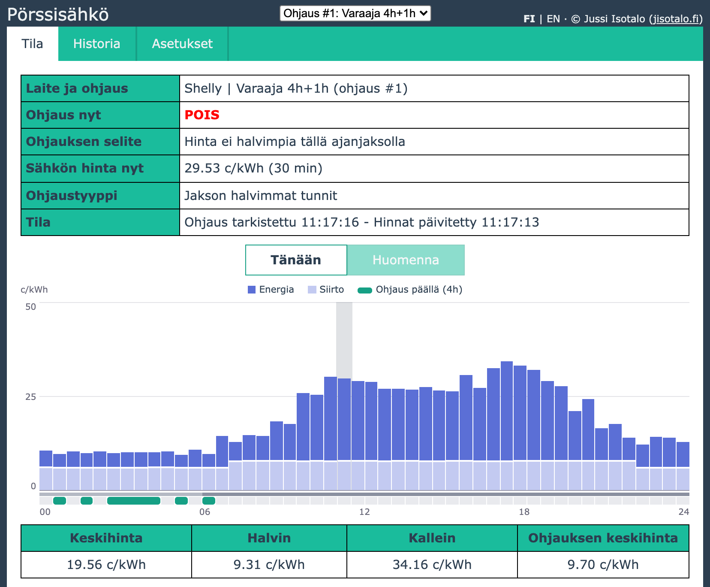

## Ominaisuudet
* Ilmainen + avoin lähdekoodi
* Oma web-serveri Shellyn sisällä ja siinä pyörivä käyttöliittymä
* Ei rekisteröitymistä
* Valvonta ja konfigurointi nettiselaimen avulla kotiverkossa (PC, puhelin, tabletti)
* Yhdestä kolmeen yhtäaikaista ohjausta eri säännöillä
* Kolme erilaista ohjaustapaa
* Ohjaus pörssin 15 minuutin hinnoilla tai niiden 30 minuutin keskiarvolla, ohjauskohtaisesti valittuna (oletus: tunnin keskiarvo kuten alkuperäisessä versiossa 3.4.0)
* Nykyisen ja seuraavan päivän hinnat sekä suunniteltu ohjaus näkyvillä kaaviona ja taulukkona
* Mahdollisuus ohjata osatunteja
* Pakko-ohjaus väliaikaisesti tai aina tietyille tunneille (ohjaus päälle tai pois)
* Vikasietoinen
  * Kerran haetut päivän hinnat pysyvät käytössä, vaikka samojen hintojen uusi haku epäonnistuisi
  * Varmuustunnit (jos ei hintoja mutta tiedetään kellonaika)
  * Hätätilaohjaus (jos ei internet-yhteyttä eikä tiedetä kellonaikaa)
* Konfiguroitavuus ja hienosäätö mahdollista omilla skripteillä
* Simulaattori ja automaattiset testit kehitystä varten

## Sisällysluettelo
- [Ominaisuudet](#ominaisuudet)
- [Muutoshistoria](#muutoshistoria)
- [Tuki ja alkuperäinen projekti](#tuki-ja-alkuperäinen-projekti)
- [Asennus](#asennus)
- [Skriptin päivitys](#skriptin-päivitys)
- [Laitteisto ja sähköinen kytkentä](#laitteisto-ja-sähköinen-kytkentä)
- [Käyttöliittymä](#käyttöliittymä)
- [Asetukset](#asetukset)
- [Lisätoiminnot ja käyttäjäskriptit](#lisätoiminnot-ja-käyttäjäskriptit)
- [HTTP-rajapinta](#http-rajapinta)
- [Kysymyksiä ja vastauksia](#kysymyksiä-ja-vastauksia)
- [Teknistä tietoa](#teknistä-tietoa)
- [License](#license)

## Muutoshistoria

Katso muutosten sisältö [CHANGELOG.md-tiedostosta](CHANGELOG.md).

Alkuperäisen projektin vanhat versiot löytyvät sen [Releases](https://github.com/jisotalo/shelly-porssisahko/releases)-sivulta.

## Tuki ja alkuperäinen projekti

Tämä on muokattu versio. Alkuperäinen tekijä ei vastaa tämän version tuesta, joten älä ilmoita tämän version ongelmia alkuperäisen projektin vikalistaan. Sovellus on tällä hetkellä sellaisenaan (as-is), ilman tukea.

Sovelluksen on alun perin tehnyt Jussi Isotalo harrastuspohjalta. Jos skriptistä on hyötyä, alkuperäistä tekijää voi tukea [alkuperäisen projektin sivulla](https://github.com/jisotalo/shelly-porssisahko#tukeminen) kerrotuilla tavoilla.

## Asennus

Skripti toimitetaan ilman takuuta, ja sen käyttö on omalla vastuullasi. Ks. [Vastuuvapaus](#license).

Shellyn **Library**-toiminto asentaa alkuperäisen version, joten tämä muokattu versio asennetaan käsin.

1. Ota Shelly käyttöön, yhdistä se verkkoon ja päivitä sen firmware. Vanhempia firmware-versioita ei tueta.
2. Avaa Shellyn hallinta **nettiselaimella**.
3. Avaa **Scripts**-sivu Shellyn hallinnasta ja luo uusi skripti (**Create script**).
4. Kopioi tiedoston [`dist/shelly-porssisahko.js`](dist/shelly-porssisahko.js) sisältö kokonaan skriptin koodiksi.
5. Paina **Save**.

    

6. Tallentamisen jälkeen laita skriptin alla konsolissa websocket debug päälle painamalla **Enable**. Tämä on tärkeää, jotta näet osoitteen ja tilatiedot käynnistyksen jälkeen. Tämä täytyy tehdä vain kerran.

    

7. Paina **Start**, jolloin skripti käynnistyy

    

8. Nyt näet skriptin alla konsolissa hallinnan osoitteen. Kopioi tämä osoite talteen ja avaa se selaimessa uudessa välilehdessä. Osoite on muotoa `http://ip-osoite/script/1`.

    

9. Siirry vielä takaisin Scripts-sivulle ja laita **Run on startup** -täppä päälle, jotta skripti käynnistyy aina Shellyn käynnistyessä.

    

10. Valmis! Avaa käyttöliittymä selaimessa (osoite kohdassa 8) ja säädä asetukset kohdilleen [Asetukset](#asetukset)-kappaleen ohjeilla.

Lisäosaversiot (ks. [Lisätoiminnot ja käyttäjäskriptit](#lisätoiminnot-ja-käyttäjäskriptit)) asennetaan samalla tavalla: pääskriptin tilalle kopioidaan halutun version tiedosto `dist/`-kansiosta.

## Skriptin päivitys

Poista nykyinen skripti (tai tyhjennä sen koodi) ja kopioi tilalle uusi versio kuten asennuksessa.

Asetukset säilyvät päivittäessä, myös päivitettäessä alkuperäisestä versiosta 3.x tähän versioon. Uudet asetukset saavat oletusarvot. Päivitys versiosta 2 nollaa asetukset.

Jos käytössäsi on oma lisäskripti tai ulkoinen ohjelma, joka lukee skriptin hintoja tai historiaa, katso [CHANGELOG.md](CHANGELOG.md) kohta "Huomioitavaa päivittäessä".

Tarkista asennuksen jälkeen, että **Run on startup** on yhä valittu.

**Paluu versioon 3.x:** versio 10 tallentaa asetuksensa omiin muistipaikkoihinsa eikä koske version 3.x asetuksiin (ks. [Mihin asetukset tallentuvat?](#mihin-asetukset-tallentuvat)). Jos vaihdat takaisin versioon 3.x, se toimii asetuksilla, jotka olivat voimassa päivityshetkellä. Versiossa 10 tehdyt muutokset eivät näy siinä. Samoin version 3.x aikana tehdyt muutokset eivät siirry, jos päivität uudelleen versioon 10.

## Laitteisto ja sähköinen kytkentä

Sähköasennukset saa tehdä vain siihen oikeutettu henkilö.

Tämän kappaleen laitesuositukset ovat alkuperäisen tekijän.

Jos ohjaat kontaktoria, on suositeltavaa käyttää Shellyn sinisiä laitteita tai Pro-malleja. Nämä kestävät kontaktorin aiheuttamia kytkentäpiikkejä. Esimerkkejä:

* Shelly Plus 1
* Shelly 1 Mini
* Shelly Pro 1, 2 ja 3

Hyvää tietoa laitteista löytyy [Shelly tuki (suomeksi)](https://www.facebook.com/groups/shellytuki) -ryhmästä.

Tämä muokattu versio (10.0.0) on testattu seuraavilla laitteilla ja laiteohjelmistoilla (tarkemmin: [test/README.md](test/README.md#laitteilla-tehdyt-testit)):
  * Shelly Outdoor Plug S Gen3 (2.0.1)
  * Shelly 1 Gen4 (tehdasversio 1.5.99 ja 2.0.1)
  * Shelly Pro 2, Gen 2 (tehdasversio 1.3.2, 1.3.3 ja 2.0.1), Wi-Fi- ja kaapeliyhteydellä

Alkuperäinen versio toimii tekijänsä mukaan ainakin seuraavilla. Tätä versiota ei ole kokeiltu niillä:
  * Shelly Plus 1PM
  * Shelly Plus 2PM
  * Shelly Plus 1
  * Shelly Pro 1
  * Shelly Pro 3
  * Shelly Pro 4PM
  * Shelly Pro3EM + Switch Add-on
  * Shelly Plus UNI
  * Shelly Plus 1 Mini
  * Shelly Plus Plug S
    * **Matter:** Gen 3 -laitteissa Matter-tuki on aina otettava pois päältä (Shellyn asetukset → Matter), muuten skripti ei käynnisty, vaan pysähtyy heti virheeseen `out_of_memory` (mitattu Shelly Outdoor Plug S Gen3, laiteohjelmisto 2.0.1; sama kuin alkuperäisen projektin [issue #32](https://github.com/jisotalo/shelly-porssisahko/issues/32)). Gen 4 -laitteissa skripti toimii myös Matter päällä, mutta jos Matterille ei ole tarvetta, kytke se pois: se jättää laiteohjelmistolle enemmän muistia ja turvaa toiminnan paremmin, vaikka skriptin oma muisti (25 186 tavua) pysyy samana

Skripti jakaa Shellyn skriptimuistin (noin 25 kilotavua) laitteen muiden skriptien kanssa. Katso [Teknistä tietoa](#teknistä-tietoa).

## Käyttöliittymä

Käyttöliittymässä on kolme välilehteä: **Tila**, **Historia** ja **Asetukset**. Käsiteltävä ohjaus valitaan alasvetovalikosta sivun ylälaidasta, ja välilehdet näyttävät aina valitun ohjauksen tiedot.

Käyttöliittymä on suomeksi tai englanniksi. Kieli valitaan selaimen kielen mukaan (suomi, muuten englanti), ja sen voi vaihtaa sivun yläreunan **FI | EN** -valinnalla. Valinta tallentuu selaimeen, ei laitteeseen.

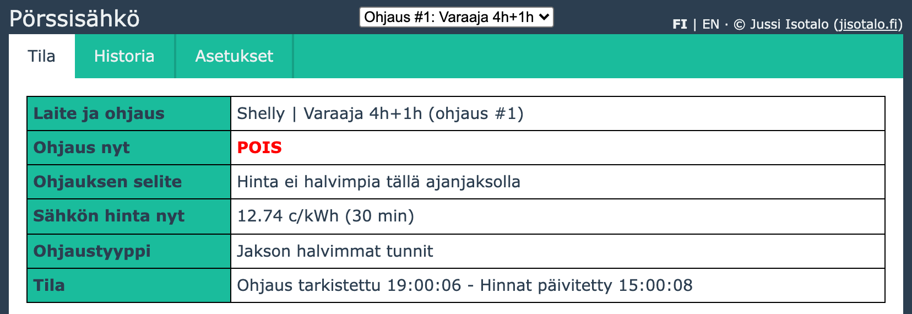

### Tila

* **Ohjauksen tila:** onko ohjaus päällä, millä perusteella, sähkön hinta nyt ja milloin ohjaus on viimeksi tarkistettu.
* **Varoitukset:** jos ohjaukselle ei ole määritetty lähtöä tai lähtöä ei löydy laitteesta, tila näytetään oranssilla ja syy kerrotaan.
* **Päivän valinta:** painikkeilla **Tänään** ja **Huomenna** valitaan, kumman päivän kaavio ja taulukko näytetään. Huomisen painike on himmennetty, kunnes huomisen hinnat on haettu.
* **Hintakaavio:** yksi pylväs jokaiselle hinnalle (24, 48 tai 96 pylvästä ohjauksen hinnan tarkkuuden mukaan).
  * Pylvään korkeus on hinta. Vaalea alaosa on asetuksissa annettu siirtomaksu ja tumma yläosa energian hinta veroineen.
  * Pylväiden alla kulkeva vihreä palkki näyttää jaksot, joilla ohjaus on suunnitelman mukaan päällä.
  * Pylväiden ja vihreän palkin välissä kulkeva ohut viiva näyttää jaksot, joista halvimmat tunnit valitaan (ohjaustapa *jakson halvimmat tunnit*). Peräkkäiset jaksot erottuvat toisistaan tummana ja vaaleana, ja jaksojen ulkopuolella viivaa ei ole. Viemällä hiiren viivan päälle näet jakson alun ja lopun. Jos koko päivä on yksi jakso, viivaa ei näytetä. Jos omat jaksot menevät limittäin, päällekkäisessä kohdassa näkyy jälkimmäinen jakso.
  * Selitteessä kohdan **Ohjaus päällä** perässä on suluissa päivän suunniteltu kytkentäaika yhteensä, esimerkiksi `(5h 15min)`. Jos omat jaksot menevät limittäin, sama aika lasketaan vain kerran.
  * Kuluva jakso on korostettu vaalealla kaistalla.
  * Viemällä hiiren pylvään päälle näet kellonajan, hinnan osineen ja ohjauksen. Vihreän palkin päällä näet jakson alun, lopun ja keston.
  * Negatiivinen energian hinta näkyy kaaviossa nollana.
* **Keskihinta, halvin ja kallein** valitulta päivältä sekä **ohjauksen keskihinta**: niiden jaksojen hintojen keskiarvo, joilla ohjaus on suunnitelman mukaan päällä. Vertaamalla sitä päivän keskihintaan näet, paljonko ohjaus hyödyttää. Jos ohjaus ei ole päivän aikana lainkaan päällä, kohdassa on viiva.
* **Ohjaustaulukko** kahdessa palstassa (00-12 ja 12-24): hinta ja suunniteltu ohjaus jokaiselle jaksolle.
  * Ohjaustavassa *jakson halvimmat tunnit* rivien taustaväri vaihtuu aina, kun jakso alkaa tai päättyy. Väri ei kerro ohjauksen tilaa. Jos omat jaksot menevät limittäin, väri vaihtuu jokaisella rajalla, eikä siitä näe, kuinka moni jakso on päällekkäin.

* **Alatunniste:** skriptin käynnistysaika ja käyntiaika, muistin käyttö ja versio. Muistirivillä "käytössä" on skriptin muistin käyttö levossa, "suurin käyttö" korkein arvo käynnistyksen jälkeen (syntyy hintoja haettaessa) ja "käytettävissä" laitteen koko skriptimuisti.


Kaavio ja taulukko näyttävät suunnitelman nykyisillä hinnoilla ja asetuksilla. Toteutuneet ohjaukset näkyvät Historia-välilehdellä.

### Historia

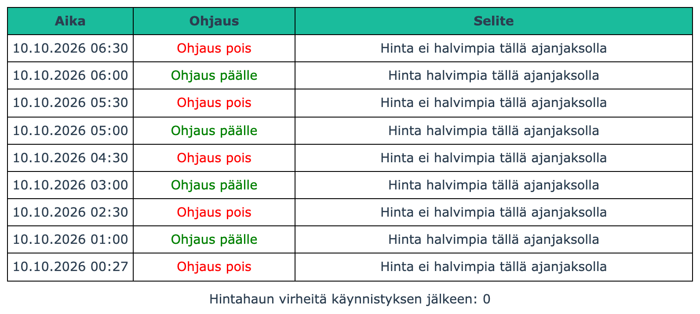

* Valitun ohjauksen viimeisimmät tilan muutokset: aika, ohjaus päälle tai pois ja syy.
* Historian pituus on asetus, ks. [Yleiset asetukset](#yleiset-asetukset). Historia on vain laitteen työmuistissa ja tyhjenee, kun skripti käynnistyy uudelleen.
* Rivi, joka on kirjattu ennen kuin laite on saanut kellonajan verkosta (heti käynnistyksen jälkeen), näkyy ajalla `00.00.0000 00:00`.
* Taulukon alla on **hintahaun virheiden määrä** käynnistyksen jälkeen ja ensimmäisen virheen aika, sekä viimeisimmän katkon alku, loppu ja virheiden määrä. Katko tarkoittaa peräkkäisiä epäonnistuneita hakuja ennen seuraavaa onnistunutta hakua. Laskuri on yhteinen kaikille ohjauksille.

**Mitä historiaan kirjataan**

Historia kertoo, milloin lähdön tila on vaihtunut ja miksi lähtö on uudessa tilassaan. Se ei ole loki käyttäjän toimista.

* Rivi kirjataan vain, kun ohjaus vaihtuu päälle tai pois ja lähdön kytkentä onnistuu. Jos tila ei muutu, riviä ei tule. Esimerkiksi pakko-ohjaus pois, kun lähtö on jo pois, ei näy historiassa.
* Selite kertoo uuden tilan syyn, ei sitä, mikä päättyi. Kun pakko-ohjaus perutaan tai sen aika loppuu, ohjaus palaa tavalliseen logiikkaan, ja rivin selite on sen mukainen:

  | Aika | Ohjaus | Selite |
  | --- | --- | --- |
  | 09:36 | Ohjaus päälle | Pakko-ohjaus |
  | 09:36 | Ohjaus pois | Hinta ei halvimpia tällä ajanjaksolla |

* Asetusten tallennus näkyy historiassa vain, jos lähdön tila muuttuu sen seurauksena.
* Jos ohjaukselle ei ole määritetty lähtöä, historiaan ei kirjata mitään.
* Kellonaika on minuutin tarkkuudella. Saman minuutin rivit ovat tapahtumajärjestyksessä, uusin ylimpänä.

## Asetukset

**Ohjaus** on sääntö, joka kytkee yhtä tai useampaa lähtöä sähkön hinnan mukaan. **Lähtö** on Shellyn rele. Ohjaus ja lähtö eivät siis ole sama asia: yksi ohjaus voi kytkeä useaa lähtöä, ja eri lähdöille voi tehdä omat ohjauksensa.

Ohjauksia voi olla rinnakkain yhdestä kolmeen. Tämä mahdollistaa esimerkiksi usean lähdön ohjauksen eri säännöillä monikanavaisilla Shelly Pro -malleilla. Uudessa asennuksessa ohjauksia on yksi, ja lisää saa yleisistä asetuksista.

Asetussivulla on ensin kaikille ohjauksille yhteiset asetukset ja niiden alla sivun ylälaidasta valitun ohjauksen omat asetukset. Numerokenttiin voi kirjoittaa vain kenttään sopivia merkkejä. Desimaalierottimena käy piste tai pilkku.

**Ohjeet:** jos asetuksen nimi on alleviivattu pisteviivalla, sillä on lyhyt ohje. Ohje aukeaa, kun viet hiiren nimen päälle tai napautat nimeä (kosketusnäytöllä). Näkyvissä oleva punainen teksti kentän vieressä on varoitus, ei ohje.

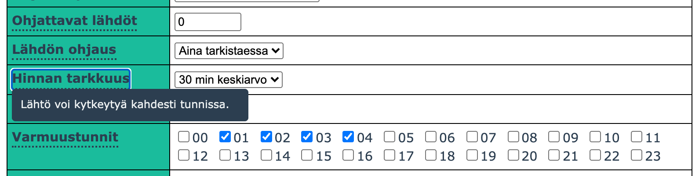

**Ohjaustavan asetukset:** sivulla näkyvät vain valitun ohjaustavan asetukset. Kun vaihdat ohjaustapaa valikosta, sen asetukset tulevat näkyviin heti. Muiden ohjaustapojen arvot säilyvät tallessa, mutta eivät vaikuta ohjaukseen.

### Yleiset asetukset

Nämä asetukset ovat samat kaikille ohjauksille.

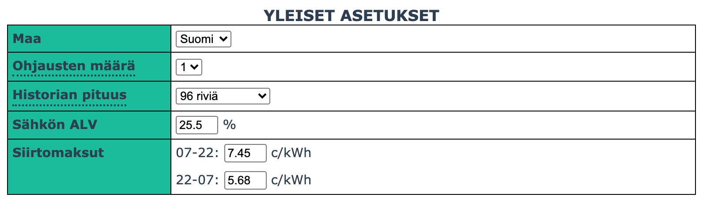

| Asetus           | Selite                                                                                                                                                                                                                                                              | Esim.                   |
| ---------------- | ------------------------------------------------------------------------------------------------------------------------------------------------------------------------------------------------------------------------------------------------------------------- | ----------------------- |
| Maa              | Maa, jonka sähkön hinnat haetaan (Suomi, Viro, Latvia, Liettua). Maan vaihtaminen hakee hinnat uudelleen.                                                                                                                                                             | `Suomi`                 |
| Ohjausten määrä  | Montako ohjausta on käytössä (1-3). Jokainen ohjaus vie laitteen muistia noin 700 tavua, vaikka se ei olisi käytössä, joten valitse vain tarvitsemasi määrä. Muutos tulee voimaan heti tallennettaessa.                                                               | `3`<br><br>Uudessa asennuksessa oletus on 1. Kun skripti päivitetään versiosta 3.x, kaikki kolme ohjausta pysyvät käytössä.<br><br>Uusi ohjaus luodaan oletusasetuksilla, eikä se ole aluksi käytössä. Jos ohjauksella on aiemmin tallennetut asetukset, ne otetaan käyttöön.<br><br>Lisäosa, joka on asetettu ohjaukselle #2 tai #3, toimii vasta, kun määrä on nostettu. |
| Historian pituus | Montako historiariviä muistissa pidetään yhteensä (0, 24, 48, 72 tai 96). Rivit jaetaan käytössä olevien ohjausten kesken: esimerkiksi 24 riviä ja kolme ohjausta tarkoittaa kahdeksaa riviä per ohjaus. Arvolla 0 historiaa ei tallenneta.                            | `24 riviä`              |
| Sähkön ALV       | Käytettävä ALV-% sähkön hinnalle. [%]                                                                                                                                                                                                                               | `25.5`                  |
| Siirtomaksut     | Jos haluat että siirtomaksut otetaan huomioon, voit syöttää ne päivä- ja yöajalle. Nämä lisätään hintoihin ja näkyvät hintakaaviossa omana osanaan. [c/kWh]<br><br>Esim. jos haluat ottaa erisuuruiset siirtomaksut huomioon tuntien valinnassa.<br><br>Siirtotuotteen valinta (uusi versiossa 10):<br>- **Aikasiirto** (oletus): päivämaksu joka päivä klo 07-22, muulloin yömaksu, kuten aiemmissa versioissa.<br>- **Kausisiirto**: päivämaksu 1.11.-31.3. maanantaista lauantaihin klo 07-22, muulloin yömaksu (myös sunnuntaisin ja koko kesäkauden). Arkipyhiä ei huomioida.<br><br>Käytössä olevat päivät ja kellonajat näkyvät maksujen kohdalla. Jos verkkoyhtiösi käyttää muita päiviä tai kellonaikoja, ne voi muuttaa [etäasetusten skriptillä](#asetusten-muokkaaminen-skriptin-kautta-etänä). | päivä: `4` <br> yö: `3` |

Asetusten tallennus ei hae hintoja uudelleen (paitsi maata vaihdettaessa). ALV:n ja siirtomaksujen muutos lasketaan muistissa olevista hinnoista.

### Ohjauskohtaiset asetukset

Nämä asetukset ovat ohjauskohtaisia.

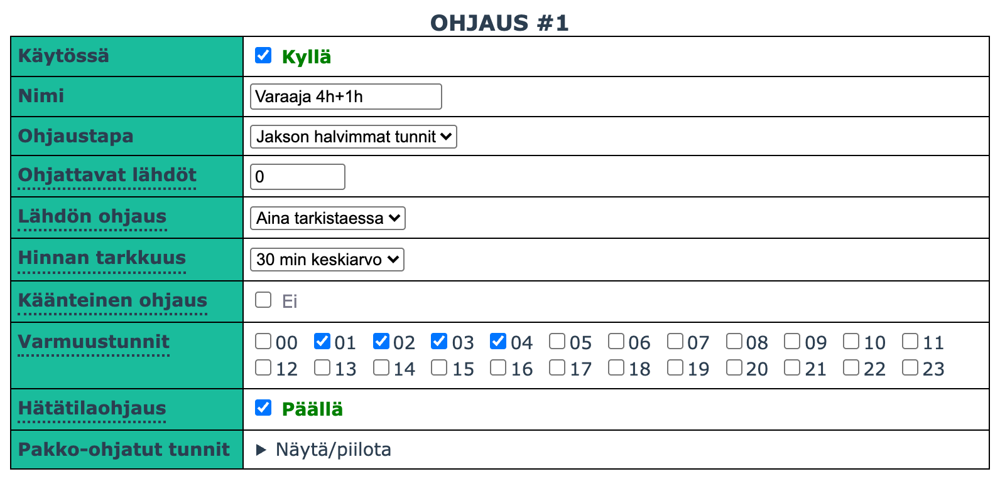


#### Yleiset

| Asetus            | Selite                                                                                                                                                                                                                                                                                                                                                                                                                                                                                                                                                            | Esim.                                                           |
| ----------------- | ----------------------------------------------------------------------------------------------------------------------------------------------------------------------------------------------------------------------------------------------------------------------------------------------------------------------------------------------------------------------------------------------------------------------------------------------------------------------------------------------------------------------------------------------------------------- | --------------------------------------------------------------- |
| Käytössä          | Onko valittu ohjaus käytössä.                                                                                                                                                                                                                                                                                                                                                                                                                                                                                                                                     | `ON`                                                            |
| Nimi              | Ohjauksen nimi, joka näkyy sivun ylälaidan valikossa.                                                                                                                                                                                                                                                                                                                                                                                                                                                                                                             | `Varaaja`                                                       |
| Ohjaustapa        | Millä ohjaustavalla lähtöä ohjataan.<br><br>Selitykset taulukon alapuolella.                                                                                                                                                                                                                                                                                                                                                                                                                                                                                      | `jakson halvimmat tunnit`                                       |
| Ohjattavat lähdöt | Shellyn ohjattavien lähtöjen ID-numerot.<br><br>Jos useampi lähtö, erota pilkulla (max. 4 kpl). <br><br>- Yksi lähtö  (mm. Shelly Plus 1) --> `0`.<br>- Useampi (esim 0, 1 ja 100) --> `0,1,100`<br><br>Kenttään voi kirjoittaa vain numeroita ja pilkkuja. Numeroiden oikeellisuutta ei tarkisteta tallennettaessa, mutta tilasivu varoittaa, jos lähtöä ei löydy laitteesta. Tyhjä kenttä tallentuu lähtönä `0`.<br><br>Lähdöt, joita ei ole minkään ohjauksen listassa, jäävät skriptiltä koskematta. Niitä voi ohjata esimerkiksi Shellyn omilla ajastuksilla.<br><br>Yksi lähtö saa olla vain yhden ohjauksen listassa. Jos kaksi ohjausta ohjaa samaa lähtöä, viimeksi ajettu ohjaus määrää lähdön tilan, myös oman jaksonsa ulkopuolella (ks. [omavalintaiset jaksot](#jakson-halvimmat-tunnit---omavalintaiset-jaksot)). | `0`                                                             |
| Lähdön ohjaus     | Ohjataanko relelähtö aina haluttuun tilaan vai ainoastaan jos tila muuttuu.<br><br>- **Aina tarkistaessa:** Lähtö asetetaan uudelleen haluttuun tilaan tunnin, 30 minuutin tai 15 minuutin välein (asetuksen **Hinnan tarkkuus** mukaan), vaikka ohjauksen tila ei muuttuisi. Jos lähtöä on välillä ohjattu muualta, esimerkiksi Shellyn sovelluksesta tai hallintasivulta, muutos kumoutuu seuraavalla kerralla.<br>- **Vain muuttuessa:** Lähtö asetetaan vain, kun ohjauksen tila vaihtuu. Lähtöä voi välillä ohjata myös muualta, ja muutos pysyy voimassa, kunnes ohjauksen tila seuraavan kerran vaihtuu.                                                                                                                                                                                 | `aina tarkistaessa`                                             |
| Hinnan tarkkuus   | Millä tarkkuudella hintaa käytetään. Ohjaus tarkistetaan ja lähtö voi vaihtua tällä välillä.<br><br>- **Tunnin keskiarvo:** tunnin neljän varttihinnan keskiarvo. Lähtö voi kytkeytyä kerran tunnissa. Toimii kuten alkuperäinen versio.<br>- **30 min keskiarvo:** kahden vartin keskiarvo, jaksot alkavat aina tasalta tai puolelta. Lähtö voi kytkeytyä kahdesti tunnissa.<br>- **15 min hinta:** jokaisen vartin oma hinta. Lähtö voi kytkeytyä jopa neljästi tunnissa.<br><br>Varmuustunnit ja pakko-ohjatut tunnit ovat aina kokonaisia tunteja.              | `tunnin keskiarvo`                                              |
| Ohjausminuutit    | Määrittää kuinka monta minuuttia tunnista ohjaus on päällä. Jos tunti on turhan pitkä aika pitää lähtöä päällä, voidaan aika muuttaa lyhyemmäksi. Asetus vaikuttaa kaikkiin ohjauksiin, pois lukien pakko-ohjaus käsin. [min]<br><br>Esim. 30 minuuttia riittää aina varaajan lämmittämiseen, joten pidetään vain tunnin ensimmäiset 30 minuuttia ohjausta päällä.<br><br>Käytössä vain, kun hinnan tarkkuus on tunnin keskiarvo.                                                                                                                                  | `60`                                                            |
| Käänteinen ohjaus | Jos ruksittu, ohjaus toimii käänteisesti normaaliin nähden. Tällöin lähtökohta on, että lähtö on päällä.<br><br>- **Varmuustunnit**: Lähtö ohjataan varmuustunneilla pois päältä<br>- **Hätätilaohjaus**: Lähtö on päinvastainen asetukseen nähden<br>- **Pakko-ohjaukset**: Lähtö voidaan pakko-ohjata pois päältä<br>- **Käsiohjaus**: Lähtö on päinvastainen asetukseen nähden<br>- **Hintaraja**: Jos hinta on alle rajan, lähtö asetetaan pois päältä<br>- **Jakson halvimmat tunnit**: Jos nykyinen tunti on halvimpia tunteja, lähtö asetetaan pois päältä | `ei`                                                            |
| Varmuustunnit     | Jos sähkön hintaa ei tiedetä, ohjataan lähtö näillä tunneilla päälle.<br><br>Esim. hintoja ei ole saatu lainkaan tai nettiyhteys on ollut poikki vuorokauden vaihtuessa.                                                                                                                                                                                                                                                                                                                                                                                          | `01:00-07:00`                                                   |
| Hätätilaohjaus    | Jos Shelly ei jostain syystä tiedä kellonaikaa, ohjataan lähtö tähän tilaan varmuuden vuoksi.<br><br>Esim. jos sähkökatkon jälkeen nettiyhteys ei palaudu (ei hintoja eikä kellonaikaa).<br><br>Laitteen käynnistyksen jälkeen odotetaan kellonaikaa kolme minuuttia ennen kuin tätä käytetään, koska kellonaika tulee yleensä sekunneissa, ja sähkökatkon jälkeen myös reititin tarvitsee aikaa käynnistyä. Sinä aikana lähtö on Shellyn oman käynnistysasetuksen mukaisessa tilassa.                                                                                                                                                                                                                                                                                                                                                                          | `ON`                                                            |
| Pakko-ohjatut tunnit | Voidaan määrittää tunnit, jolloin ohjaus asetetaan joko päälle tai pois riippumatta sähkön hinnasta ja muista ohjauksista (pl. [tilapäinen pakko-ohjaus](#tilapäinen-pakko-ohjaus)).<br><br>Esim. jos haluat lämmittää varajaa joka aamu tai estää ohjauksen tiettynä osana vuorokaudesta.                                                                                                                                                                                                                                                                                                         | `05:00-07:00` ja `19:00-21:00` päällä<br><br>`01:00-02:00` pois |

#### Toiminta sähkökatkon jälkeen

**Sähkökatkon jälkeen** hintaohjaus alkaa heti, kun verkkoyhteys on palannut, laite on saanut kellonajan ja hinnat on haettu; tavallisesti tähän menee alle puoli minuuttia. Siihen asti lähtöä ohjataan näin:

- Kunnes kellonaika on saatu, skripti ei ohjaa lähtöä, vaan se on Shellyn omassa asetuksessa määritetyssä käynnistystilassa (lähdön asetus *Action on power on*). Tavallisesti kellonaika saadaan sekunneissa, kun verkkoyhteys on palautunut.
- Kun kellonaika on saatu, skripti hakee ensin hinnat ja ohjaa lähtöä vasta sen jälkeen suoraan hintojen mukaan, kun hinnat ja kellonaika ovat tiedossa.
- Vain jos hintojen haku epäonnistuu kolmesti peräkkäin (noin 15 sekuntia), lähtöä ohjataan varmuustuntien mukaan, kunnes hinnat saadaan. Hakua yritetään uudelleen, ks. [Miksi hintatietoja ei saada?](#miksi-hintatietoja-ei-saada).
- Jos kellonaikaa ei saada kolmen minuutin kuluessa laitteen käynnistyksestä, lähtöä ohjataan hätätilaohjauksen mukaan, kunnes kellonaika saadaan.
- Käsiohjaus toimii heti ilman kellonaikaa ja hintoja.

Aseta Shellyn lähdön käynnistystila (*Action on power on*), hätätilaohjaus ja varmuustunnit, jotta toiminta katkojen aikana on haluamasi: ne määräävät lähdön tilan tässä järjestyksessä, kunnes hinnat on saatu. Toipuminen on vakaampaa ja nopeampaa, kun reititin ja muut verkon laitteet ovat UPS-varmennetussa sähkössä: silloin Shelly saa kellonajan ja hinnat heti käynnistyttyään. Hintoja ei tallenneta laitteen pysyvään muistiin.

#### Käsiohjaus

Voimassa, jos valittu ohjaustapa on käsiohjaus.

Käsiohjauksella lähtö ohjataan käyttöliittymältä asetettuun tilaan.


| Asetus | Selite                            | Esim. (kuva yllä) |
| ------ | --------------------------------- | ----------------- |
| Ohjaus | Asetetaanko lähtö päälle vai pois | `ON`              |

#### Hintaraja

Voimassa, jos valittu ohjaustapa on hintaraja.

Hintarajaohjauksella lähtö asetetaan päälle jos sähkön hinta on alle määritellyn rajan (tai juuri sen verran). Hinta on valitun hinnan tarkkuuden mukainen: tunnin keskiarvo, 30 minuutin keskiarvo tai 15 minuutin hinta.


| Asetus    | Selite                                                                                                                                             | Esim. (kuva yllä) |
| --------- | -------------------------------------------------------------------------------------------------------------------------------------------------- | ----------------- |
| Hintaraja | Hinta, jossa ja jonka alla lähtö asetetaan päälle. [c/kWh]<br><br>Voit syöttää tähän myös arvon `avg`, jolloin rajana on päivän keskihinta. Raja voi olla myös negatiivinen. | `8`            |

#### Jakson halvimmat tunnit

Voimassa, jos valittu ohjaustapa on jakson halvimmat tunnit.

Jakson halvimmat tunnit -ohjauksella vuorokausi jaetaan osiin. Lähtö ohjataan päälle jokaisen osan halvimpina aikoina. Lisäksi voidaan määrittää raja jonka alla ohjaus on aina päällä.

Jos hinnan tarkkuus on 30 tai 15 minuuttia, valinta tehdään puolituntisista tai varteista: esimerkiksi tuntimäärä 2 tarkoittaa 15 minuutin tarkkuudella jakson kahdeksaa halvinta varttia, jotka voivat olla hajallaan.

Vuorokausi voidaan jakaa tasaisiin osiin (esim. 8h välein) tai syöttää omat käytettävät aikavälit (esim. aamu ja ilta).

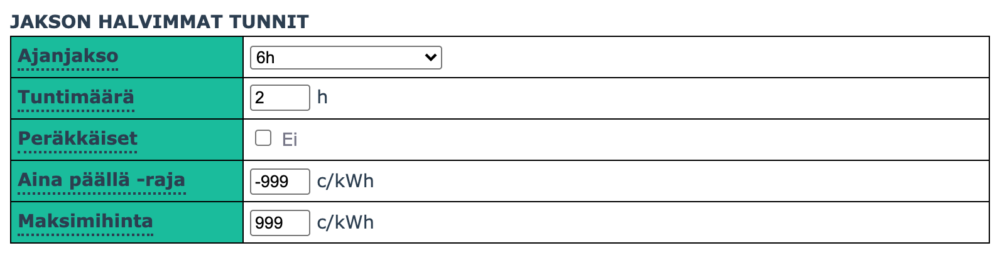

| Asetus            | Selite                                                                                                                                                                                                                                                                                                                       | Esim. (kuva yllä) |
| ----------------- | ---------------------------------------------------------------------------------------------------------------------------------------------------------------------------------------------------------------------------------------------------------------------------------------------------------------------------- | ----------------- |
| Ajanjakso         | Minkä mittaisiin jaksoihin vuorokausi jaetaan. Jokaiselta jaksolta haetaan sitten halvimmat ajat (tunnit, puolituntiset tai vartit hinnan tarkkuuden mukaan). [h]<br><br>Vaihtoehtona on myös `oma valinta`. Tällöin kellonajat voidaan syöttää itse. Katso lisätietoa kappaleesta [Jakson halvimmat tunnit - omavalintaiset jaksot](#jakson-halvimmat-tunnit---omavalintaiset-jaksot) | `6`               |
| Tuntimäärä        | Kuinka monta halvinta tuntia lähtö ohjataan päälle ajanjakson aikana.<br><br>Eli jos ajanjakso on 6h ja tuntimäärä 2, kello 00:00-06:00 lähtö ohjataan päälle kahtena halvimpana tuntina. Kuten myös kello 06:00-12:00 ja niin edelleen.<br><br>Tunnin keskiarvolla kokonaiset tunnit. 30 minuutin tarkkuudella 0.5 h välein (esim. `1.5`) ja 15 minuutin tarkkuudella 0.25 h välein (esim. `1.25`). Arvo pyöristetään tallennettaessa.                                                                                     | `2`               |
| Peräkkäiset       | Jos käytössä, valitut ajat ovat peräkkäin: ajanjaksosta valitaan halvin yhtenäinen aika, jonka pituus on annettu tuntimäärä.<br><br>Näin yksittäisiä halvimpia aikoja ei välttämättä hyödynnetä, mutta lähtö on päällä yhtäjaksoisesti. Katso esimerkki alta.<br><br>30 ja 15 minuutin tarkkuudella yhtenäinen aika voi alkaa mistä tahansa puolituntisesta tai vartista, mutta ei ylitä ajanjakson rajaa.<br><br>Kahden oman jakson kanssa asetus valitaan kummallekin jaksolle erikseen (**Peräkkäiset** ja **Peräkkäiset 2**). | `ei` |
| Aina päällä -raja | Jos sähkö on tätä halvempaa (tai juuri tämän hintaista) niin lähtö on aina päällä. [c/kWh]<br><br>Voit syöttää tähän myös arvon `avg`, jolloin rajana on päivän keskihinta.                                                                                                                                           | `-999` (ei käytössä)            |
| Maksimihinta      | Jos sähkön hinta on tätä korkeampi, lähtöä ei aseteta päälle vaikka tunti olisikin halvimpia tunteja. Maksimihinta ohittaa myös aina päällä -rajan. [c/kWh]<br><br>Voit syöttää tähän myös arvon `avg`, jolloin rajana on päivän keskihinta.<br><br>*Tämän kanssa pitää olla tarkkana, jos tulee kalliita päiviä.*                                                  | `999` (ei käytössä)              |

Alla on esimerkki suunnitellusta ohjauksesta 10.10.2026 hinnoilla ja yllä olevilla asetuksilla (6 h jaksot, 2 halvinta tuntia, tunnin tarkkuus). Jokaisesta jaksosta (00-06, 06-12, 12-18 ja 18-24) on valittu kaksi halvinta tuntia. Vihreä palkki kaavion alla ja taulukon merkit näyttävät, milloin lähtö on päällä, ja jaksot erottuvat taulukossa taustaväristä.

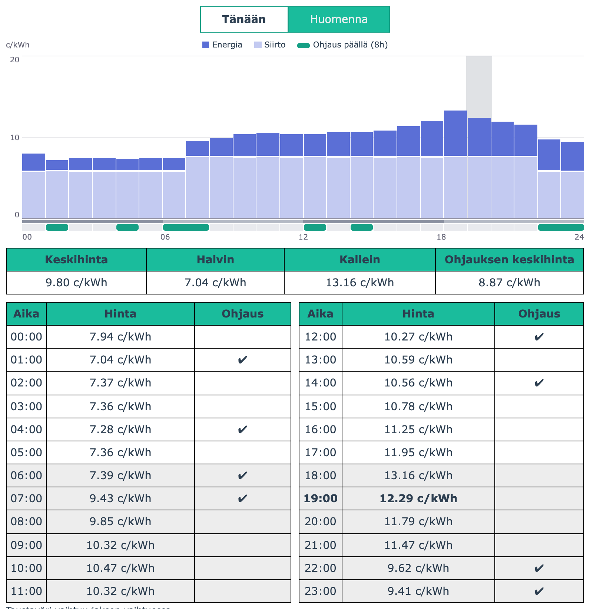

Alla on havainnollistettu **peräkkäiset**-asetuksen vaikutusta. Esimerkkikuvissa vuorokausi on jaettu 4 tunnin jaksoihin ja jokaisesta jaksosta valitaan 3 tuntia (10.10.2026 hinnat, tunnin tarkkuus).

Asetus vaihtaa valinnan "jakson halvimmat yksittäiset tunnit" muotoon "jakson halvin yhtenäinen jakso". Esimerkkinä jakso 16-20:

| Tunti | 16 | 17 | 18 | 19 |
| --- | --- | --- | --- | --- |
| Hinta (c/kWh) | 11.25 | 11.95 | 13.16 | 12.29 |

**Ei käytössä (oletusarvo):**

Valitaan jokaisesta jaksosta kolme halvinta tuntia riippumatta siitä, ovatko ne vierekkäin. Jaksosta 16-20 valitaan 16, 17 ja 19. Kallein tunti 18 jää väliin, joten lähtö on päällä 16-18, pois 18-19 ja taas päällä 19-20.

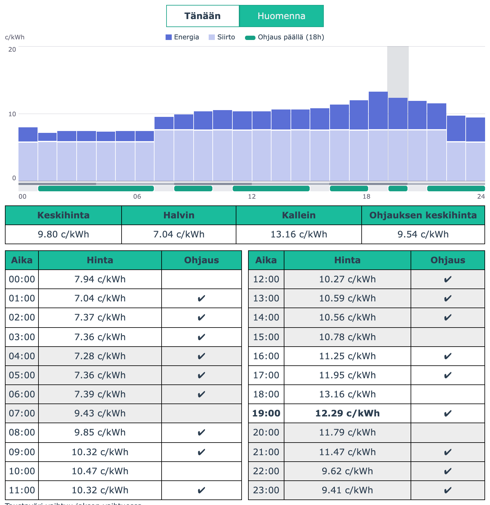

**Käytössä:**

Kolmen tunnin pitää olla yhtenäinen jakso. Neljän tunnin jaksoon niitä mahtuu kaksi:

| Vaihtoehto | Tunnit | Keskihinta (c/kWh) |
| --- | --- | --- |
| A | 16, 17, 18 | 12.12 |
| B | 17, 18, 19 | 12.47 |

Valitaan A, koska se on halvempi. Kello 18 on mukana kummassakin vaihtoehdossa, joten kalleinta tuntia ei voi välttää: valinta tehdään siitä, kumpi reunatunti otetaan mukaan. Sama näkyy jaksossa 08-12, jossa halvimmat tunnit ovat 08, 09 ja 11, mutta peräkkäisinä valitaan 08-10.

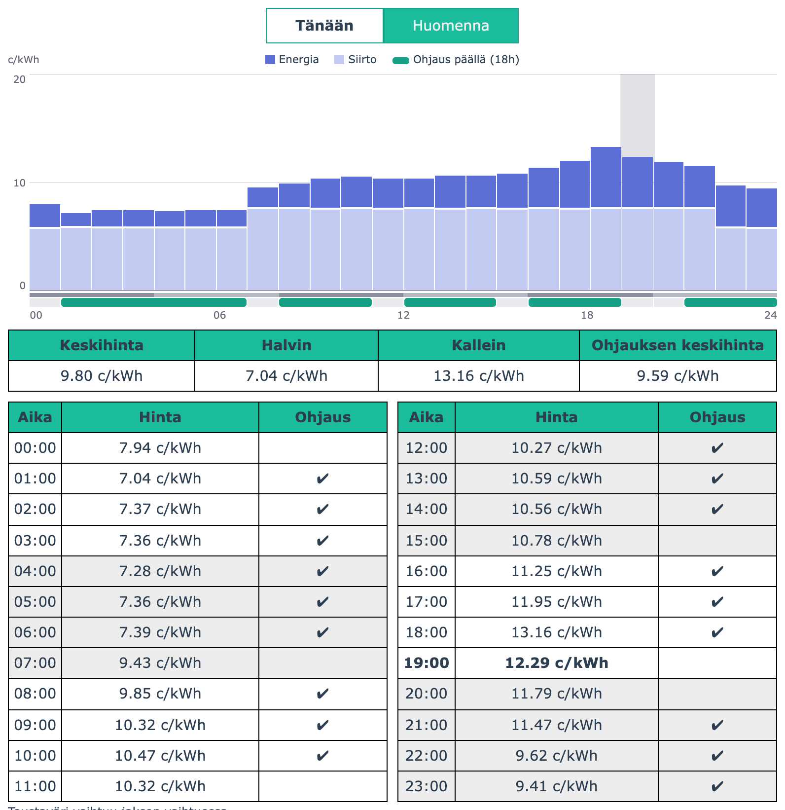

**Mitä asetuksella voitetaan ja mitä se maksaa:** lähtö kytkeytyy jaksossa kerran päälle ja kerran pois, mikä sopii laitteille, jotka eivät pidä katkonaisesta käytöstä tai tarvitsevat yhtenäisen käyntiajan. Vastineeksi hinta on hieman korkeampi: esimerkin jaksossa kolmen tunnin keskihinta on 12.12 eikä 11.83 c/kWh.

### Jakson halvimmat tunnit - omavalintaiset jaksot

Asetuksiin voidaan syöttää vaihtoehtoisesti yksi tai kaksi omavalintaista jaksoa tuntimäärineen. Tämän avulla saadaan helposti tehtyä esimerkiksi "*kolme halvinta tuntia yöllä kello 00-06 väliltä ja yksi halvin tunti illalla kello 18-21 väliltä*" -tyylinen ohjaus.

Valittaessa ajanjaksoksi `oma valinta`, voidaan syöttää halutut kellonajat ja tuntimäärät alla olevan kuvan mukaisesti. Jaksojen rajat ovat kokonaisia tunteja ja noudattavat kellonaikaa myös kellonsiirtopäivinä.

Oma jakso rajaa vain sen, mistä kellonajoista halvimmat valitaan. Ohjaus on toiminnassa koko vuorokauden: jakson ulkopuolella sen tulos on "pois", ja se ohjaa lähtönsä sen mukaan. Siksi kahta eri jaksoille asetettua ohjausta ei voi laittaa samalle lähdölle, vaan tällaiseen käyttöön ovat yhden ohjauksen kaksi omaa jaksoa.

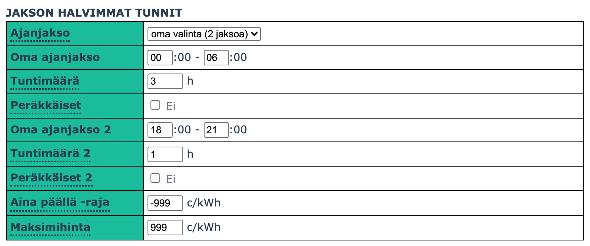

Tällöin ohjaus voisi mennä esimerkiksi seuraavasti:

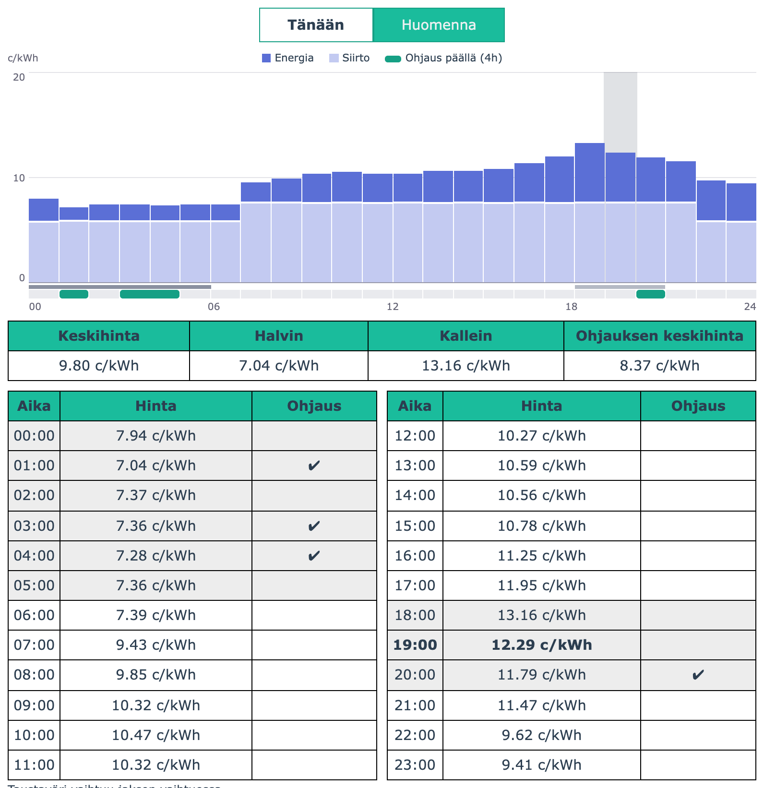

Kuvassa yöjaksosta 00-06 on valittu kolme halvinta tuntia (01, 03 ja 04) ja iltajaksosta 18-21 yksi (20).

### Tilapäinen pakko-ohjaus

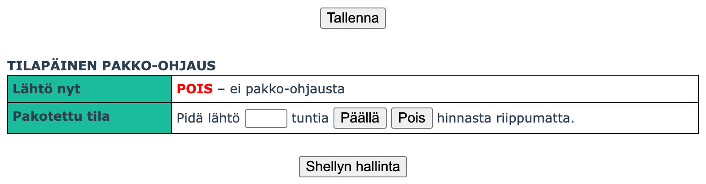

Tilapäinen pakko-ohjaus pitää valitun ohjauksen lähdöt halutussa tilassa määräajan hinnasta ja muista asetuksista riippumatta. Sen jälkeen ohjaus palaa tavalliseen toimintaan. Se ei tallennu asetuksiin, toisin kuin joka päivä toistuvat [pakko-ohjatut tunnit](#yleiset).

* Rivi **Lähtö nyt** kertoo lähdön tilan juuri nyt.
* Kirjoita rivillä **Pakotettu tila** kesto tunteina (myös osatunnit, esim. `0.5` on puoli tuntia) ja paina **Päällä** tai **Pois**.
* Painalluksen jälkeen rivillä näkyy hetken odotusmerkki, kunnes laite on ottanut pakko-ohjauksen käyttöön. Tähän menee yleensä muutama sekunti.
* Pakko-ohjauksen voi tehdä myös siihen tilaan, jossa lähtö jo on. Silloin tila ei vaihdu, mutta se pysyy samana, vaikka hinta muuttuisi.
* Kun pakko-ohjaus on voimassa, rivillä näkyy sen tila ja päättymisaika sekä painike **Peru**:

  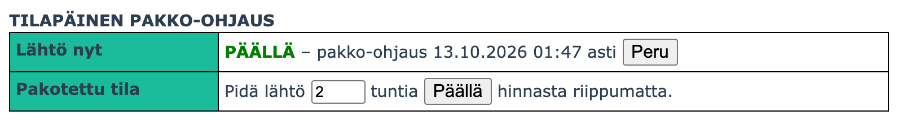

* Voimassa olevan pakko-ohjauksen aikana näkyvissä on vain saman suunnan painike. Sillä pakko-ohjausta voi jatkaa: uusi kesto lasketaan painallushetkestä. Suunnan vaihtamiseksi pakko-ohjaus perutaan ensin, jolloin ohjaus palaa hetkeksi tavalliseen toimintaan.
* Kesto lasketaan laitteen kellosta. Pakko-ohjaus ei säily skriptin uudelleenkäynnistyksen yli.

Sivun lopussa oleva **Shellyn hallinta** avaa uudessa välilehdessä Shellyn oman hallintasivun.

## Lisätoiminnot ja käyttäjäskriptit

Skriptiä voi jatkojalostaa omalla koodilla. Lisäosa ei ole erillinen skripti, vaan se yhdistetään pääskriptiin rakennusvaiheessa: laitteelle asennetaan pääskriptin sijaan valmis lisäosaversio `dist/`-kansiosta. Alla olevat esimerkit löytyvät valmiina.

| Skripti                                                                                    | Selitys                                                                                                                                                                                                                                            |
| ------------------------------------------------------------------------------------------ | -------------------------------------------------------------------------------------------------------------------------------------------------------------------------------------------------------------------------------------------------- |
| [`shelly-porssisahko-open-meteo-api.js`](dist/shelly-porssisahko-open-meteo-api.js)         | Hakee vuorokauden kylmimmän lämpötilan Open-Meteo-palvelusta (ei vaadi tunnuksia) ja muuttaa sen perusteella halvimpien tuntien lukumäärää. Jos ennustetta ei saada, ohjataan asetetuilla tunneilla ja haku yritetään uudelleen seuraavalla ohjauksen tarkistuksella. |
| [`shelly-porssisahko-addon-temp-hours.js`](dist/shelly-porssisahko-addon-temp-hours.js)     | Muuttaa halvimpien tuntien lukumäärää Shelly Plus Addonin mittaaman lämpötilan perusteella                                                                                                                                                         |
| [`shelly-porssisahko-addon-temp.js`](dist/shelly-porssisahko-addon-temp.js)                 | Ylikirjoittaa ohjauksen tarvittaessa Shelly Plus Addonin mittaaman lämpötilan perusteella                                                                                                                                                          |
| [`shelly-porssisahko-ht-sensor-temp.js`](dist/shelly-porssisahko-ht-sensor-temp.js)         | Muuttaa halvimpien tuntien lukumäärää Shelly H&T:n lähettämän lämpötilan perusteella. Yli 12 tuntia vanhaa lämpötilaa ei käytetä.                                                                                                                   |
| [`shelly-porssisahko-1-instance-no-history.js`](dist/shelly-porssisahko-1-instance-no-history.js) | Yksi ohjaus ilman historiaa. **Ei suositella:** käytä tavallista skriptiä ja valitse asetuksista Ohjausten määrä 1 ja Historian pituus 0. Muistia kuluu yhtä paljon tai vähemmän, lopputulos on sama ja määriä voi myöhemmin muuttaa. Versiosta 3.x päivittäessä nämä kaksi asetusta pitää muuttaa itse. Mukana vain yhteensopivuuden vuoksi.                                                                                                                                                                                         |
| [`shelly-porssisahko-config.js`](dist/shelly-porssisahko-config.js)                         | Rinnalle asennettava erillinen skripti, jonka avulla voi muuttaa pörssisähköohjauksen asetuksia ilman web-käyttöliittymää (esim. etänä puhelimella). Tsekkaa [Asetusten muokkaaminen skriptin kautta (etänä)](#asetusten-muokkaaminen-skriptin-kautta-etänä) |

Lisäosien lähdekoodi on kansiossa `src/after-build/`. Lisäosan kehittämisestä ja testaamisesta kerrotaan tiedostossa [test/README.md](test/README.md).

### Ominaisuudet

Skripti kutsuu seuraavia funktiota eri tilanteissa, mikäli ne ovat määritelty. Katso esimerkkejä niiden käytöstä yllä olevista skripteistä.

<small>

| Funktio         | Määrittely                                                                       | Parametrit                                                                                                 | Selitys                                                                                                                                                           |
| --------------- | -------------------------------------------------------------------------------- | ---------------------------------------------------------------------------------------------------------- | ----------------------------------------------------------------------------------------------------------------------------------------------------------------- |
| `USER_CONFIG`   | `USER_CONFIG(inst: number, initialized: boolean) => void`                        | `inst` = ohjauksen numero (`0, 1, 2`)<br>`initialized` = asetukset ovat muuttuneet                         | Kutsutaan kun asetukset ovat muuttuneet tai juuri ennen logiikan suoritusta. Funktion sisällä voidaan ylikirjoittaa asetuksia.                                    |
| `USER_OVERRIDE` | `USER_OVERRIDE(inst: number, cmd: boolean, callback: function(boolean)) => void` | `inst` = ohjauksen numero (`0, 1, 2`)<br>`cmd` = logiikan määrittämä komento<br>`callback` = takaisinkutsu | Kutsutaan kun ohjauslogiikka on suoritettu. Tässä voi vielä ylikirjoittaa skriptin ohjauksen. `callback()`-funktiota **pitää** kutsua halutulla komennon arvolla. Arvo `null` pyytää ajamaan logiikan uudelleen. |
| `USER_LOOP`     | `USER_LOOP() => void`                                                            |                                                                                                            | Kutsutaan ohjelman ajastinsilmukassa mikäli ei ole muuta tehtävää (10s välein). Funktion **pitää** kirjoittaa `loopRunning = false` kun valmis.                   |

</small>

Huomioitavaa omaa lisäosaa tehdessä:

* Asetukset (`_.c`) ja tilatiedot kuten `_.s.p[0].now`, `avg`, `low` ja `high` ovat käytettävissä kuten alkuperäisessä versiossa.
* Hinnat (`_.p`) ja historia (`_.h`) ovat pakattuja merkkijonoja, eivät taulukoita. Hinnat saa käyttöön funktiolla `calcPrices`. Katso [docs/vertailu-3.4.0.md](docs/vertailu-3.4.0.md).
* Tee raskas laskenta ajastimesta tai `USER_LOOP`-funktiosta, älä `Shelly.call`-kutsun vastauskäsittelijän sisällä. Vanhemmissa (Gen 2) laitteissa kutsupino loppuu vastauskäsittelijöissä nopeasti, ja skripti pysähtyy.

### Asetusten muokkaaminen skriptin kautta (etänä)

Tämä voi olla kätevä, jos skriptin asetuksia täytyy muuttaa ilman pääsyä skriptin omaan hallintaan.
Esimerkiksi Shellyn sovelluksen kautta etänä.

1. Asenna [`shelly-porssisahko-config.js`](dist/shelly-porssisahko-config.js) omaksi skriptikseen pääskriptin **rinnalle** (pidä pääskripti päällä kuten ennenkin). Pääskriptin pitää olla käynnistynyt vähintään kerran, jotta asetukset ovat olemassa.
2. Ota kommentit (`//`) pois koodista niiden asetusten kohdalta, joita haluat muokata. Muut pysyvät ennallaan.
3. Paina **save** ja käynnistä skripti. Se sammuu automaattisesti.

Muutokset tulevat voimaan heti kaikissa ohjauksissa. Lähtö- ja nimilista korvataan kokonaan annetulla listalla.

Esim. alla muutetaan etänä halpojen tuntien lukumäärä arvoon `8h` yhdestä ohjauksesta.

Siirtomaksujen päivät ja kellonajat ovat yleisissä asetuksissa, eikä niitä muuteta asetussivulla. Ne tallentuvat laitteen muistiin, joten ne säilyvät pääskriptin päivityksissä ja toimivat kaikkien lisäosaversioiden kanssa:

| Asetus | Selite | Oletus |
| --- | --- | --- |
| `ss`, `se` | Kausisiirron ensimmäinen ja viimeinen päivä muodossa kuukausi × 100 + päivä. Kausi voi jatkua vuodenvaihteen yli. | `1101` (1.11.), `331` (31.3.) |
| `ds`, `de` | Päivämaksun alkamis- ja päättymistunti. Koskee molempia siirtotuotteita. | `7`, `22` (klo 07-22) |

**Kirjoita päivät ilman etunollaa**, esimerkiksi `331` eikä `0331`. Shelly lukee etunollallisen luvun oktaalilukuna, jolloin `0331` olisi `217` eli 17.2. Virheestä ei tule ilmoitusta, koska 17.2. on kelvollinen päivä.


## HTTP-rajapinta

Käyttöliittymä käyttää skriptin omaa HTTP-rajapintaa, ja samoja pyyntöjä voi lähettää myös ulkoinen järjestelmä (esimerkiksi kotiautomaatio). Osoite on sama kuin käyttöliittymän, ja pyynnön tyyppi annetaan parametrilla `r`:

```
http://<laitteen osoite>/script/<skriptin numero>?r=<pyyntö>&i=<ohjaus>
```

Parametri `i` on ohjauksen numero nollasta alkaen: ohjaus #1 on `0`, ohjaus #2 on `1` ja ohjaus #3 on `2`.

Kun skripti on juuri ajamassa logiikkaa tai hakemassa hintoja, se vastaa koodilla `503`. Lähetä pyyntö silloin uudelleen hetken kuluttua.

Vältä toistuvia pyyntöjä. Laitteen muisti ja suoritusteho ovat rajalliset, joten älä lue tilaa (`r=s`) jatkuvasti ulkoisesta automaatiosta. Hinta ja lähdön tila näkyvät skriptin käyttöliittymässä, ja lähdön tila myös laitteen omassa rajapinnassa.

Jos laitteeseen on asetettu salasana, jokainen pyyntö vaatii digest-todennuksen käyttäjätunnuksella `admin`. Esimerkiksi curlilla:

```
curl --digest -u admin "http://<laitteen osoite>/script/1?r=s&i=0"
```

### Pakko-ohjaus (`r=f`)

Pitää ohjauksen halutussa tilassa määräajan hinnasta riippumatta, kuten asetussivun [tilapäinen pakko-ohjaus](#tilapäinen-pakko-ohjaus). Sopii tilapäiseen tai usein toistuvaan ohjaukseen: mitään ei tallenneta laitteen pysyvään KVS-muistiin.

| Parametri | Selite |
| --- | --- |
| `mi` | Kesto minuutteina tästä hetkestä. `0` peruu voimassa olevan pakko-ohjauksen. |
| `c` | `1` = ohjaus päälle, `0` = ohjaus pois |

Esimerkkejä (ohjaus #1, skripti numero 1):

```
Päälle tunniksi:          /script/1?r=f&i=0&mi=60&c=1
Pois kahdeksi tunniksi:   /script/1?r=f&i=0&mi=120&c=0
Peruutus:                 /script/1?r=f&i=0&mi=0&c=0
```

* Onnistunut pyyntö palauttaa koodin `204` ilman sisältöä, ja lähtö seuraa parissa sekunnissa.
* Laite laskee päättymisajan omasta kellostaan, joten lähettäjän kellolla ei ole merkitystä.
* `c` on ohjauksen tila ennen mahdollista kääntöä: jos **Käänteinen ohjaus** on käytössä, `c=1` kytkee lähdön pois.
* Uusi pyyntö korvaa voimassa olevan pakko-ohjauksen. Kestoa voi näin pidentää tai lyhentää: `mi` on aina kesto pyyntöhetkestä, ei lisäys jäljellä olevaan aikaan. Kun suunta pysyy samana, lähtö ei katkea välillä.
* Pakko-ohjaus ei säily skriptin uudelleenkäynnistyksen yli.
* Virheellinen `mi` (ei luku tai negatiivinen) jätetään huomiotta.

**Aiempi tapa toimii edelleen.** Alkuperäisessä versiossa kesto annettiin päättymisaikana parametrilla `ts` (Unix-aikaleima sekunteina, `0` peruu), esimerkiksi `/script/1?r=f&i=0&ts=1791665827&c=1`. Se säilyy yhteensopivuuden vuoksi, joten vanhoja pyyntöjä ei tarvitse muuttaa. Jos pyynnössä on sekä `mi` että `ts`, käytetään arvoa `mi`. Parametri `mi` on uusi versiossa 10.

### Asetusten muuttaminen (`r=w`)

Muuttaa ohjauksen tallennettuja asetuksia nimetyillä parametreilla ja ottaa muutetut asetukset käyttöön, kuten asetussivun Tallenna. Uusi versiossa 10.

Pyynnöllä voi muuttaa ne asetukset, joita on mielekästä säätää tilanteen mukaan ulkoisesta järjestelmästä. Muut asetukset tehdään asetussivulla.

| Parametri | Asetus | Arvo |
| --- | --- | --- |
| `en` | Käytössä | `1` = käytössä, `0` = pois käytöstä |
| `o` | Ohjattavat lähdöt | Lähtöjen numerot pilkulla erotettuna, enintään neljä (esim. `0` tai `0,1`). Tyhjä arvo poistaa kaikki lähdöt |
| `f` | Pakko-ohjatut tunnit | 24 merkkiä, yksi jokaiselle tunnille 00-23: `1` = päälle, `0` = pois, `-` = ei pakko-ohjausta |
| `m2.c` | Tuntimäärä (jakson halvimmat tunnit) | Luku 0-24, myös desimaalit (esim. `1.5`) |
| `m2.c2` | Tuntimäärä 2 (toinen oma jakso) | Luku 0-24, myös desimaalit |
| `m1.l` | Hintaraja | Luku tai `avg` |
| `m2.l` | Aina päällä -raja | Luku tai `avg` |
| `m2.m` | Maksimihinta | Luku tai `avg` |
| `m0.c` | Käsiohjauksen tila, ks. [Käsiohjaus](#käsiohjaus) | `1` = päälle, `0` = pois |

```
Kuusi halvinta tuntia:                 /script/1?r=w&i=0&m2.c=6
Lähdöt 0 ja 1 ohjaukseen:              /script/1?r=w&i=0&o=0,1
Ohjaus pois käytöstä:                  /script/1?r=w&i=0&en=0
Tunnit 17 ja 18 aina päälle:           /script/1?r=w&i=0&f=-----------------11-----
Pakko-ohjatut tunnit pois:             /script/1?r=w&i=0&f=------------------------
Useita kerralla:                       /script/1?r=w&i=0&m2.c=4&m2.m=25
Käsiohjaus päälle:                     /script/1?r=w&i=0&m0.c=1
Käsiohjaus pois:                       /script/1?r=w&i=0&m0.c=0
```

* Onnistunut pyyntö palauttaa koodin `204` ilman sisältöä. Asetukset tulevat voimaan muutaman sekunnin kuluessa, ja ohjaus ajetaan heti uusilla asetuksilla.
* Jos yksikin arvo on virheellinen tai parametri on tuntematon, pyyntö palauttaa koodin `400` eikä mitään tallenneta.
* Yhdessä pyynnössä voi olla useita parametreja. Ne tallennetaan kerralla.
* Jos arvot ovat jo samat, mitään ei kirjoiteta. Saman pyynnön toistaminen on siis harmitonta.
* Tuntimäärä, joka on jaksoa pidempi, tarkoittaa jakson kaikkia tunteja.
* **Ohjaustapaa ei vaihdeta.** Käsiohjauksen tila (`m0.c`) vaikuttaa lähtöön vain, kun ohjauksen ohjaustavaksi on asetuksissa valittu **Käsiohjaus**. Vastaavasti tuntimäärät ja hintarajat vaikuttavat vain omassa ohjaustavassaan. Arvo tallentuu silti aina.
* Arvoissa käytetään vain merkkejä, jotka kulkevat osoitteessa sellaisenaan (numerot, piste, miinusmerkki ja pilkku). Pilkku kelpaa myös muodossa `%2C`.
* Jokainen muutos kirjoittaa laitteen pysyvään KVS-muistiin, joka kestää rajallisen määrän kirjoituksia. Tiheään toistuvaan kytkemiseen (esimerkiksi minuuttien välein) käytä [pakko-ohjausta](#pakko-ohjaus-rf), joka ei kirjoita mitään pysyvään muistiin.
* Jos asetussivu on auki, kun asetuksia muutetaan pyynnöllä, sivun kentissä näkyvät vielä vanhat arvot. Sivulta tallentaminen kirjoittaisi ne takaisin, joten lataa sivu ensin uudelleen.

### Tilan lukeminen (`r=s`)

Palauttaa ohjauksen tilan, asetukset ja hinnat JSON-muodossa. Hyödyllisimmät kentät:

| Kenttä | Sisältö |
| --- | --- |
| `si.cmd` | Lähdön tila nyt (`1` = päällä, `0` = pois) |
| `si.st` | Tilan syy numerona: 0 käynnistetään (odotetaan kellonaikaa), 1 käsiohjaus, 2 hinta alle rajan, 3 hinta yli rajan, 4 ei halvimpia, 5 halvimpia, 6 alle aina päällä -rajan, 7 varmuustunnit, 8 hätätilaohjaus, 9 pakko-ohjaus, 10 pakko-ohjattu tunti, 11 yli maksimihinnan, 12 lisäskripti, 13 ohjausminuutit käytetty |
| `si.fCmdTs`, `si.fCmd` | Voimassa olevan pakko-ohjauksen päättymisaika (0 = ei pakko-ohjausta) ja tila |
| `si.chkTs` | Milloin ohjaus on viimeksi tarkistettu |
| `s.v` | Skriptin versio, esimerkiksi `10.0.0`. Versiosta 10 alkaen hinnat ja historia ovat pakattuja (ks. [docs/unpack.md](docs/unpack.md)), versiossa 3.x taulukoita. |
| `s.p[0].now`, `avg`, `low`, `high` | Sähkön hinta nyt sekä päivän keskihinta, halvin ja kallein (c/kWh, ALV ja siirtomaksu mukana). `s.p[1]` on huominen. |
| `s.errTot`, `s.errT0` | Epäonnistuneiden hintahakujen määrä käynnistyksen jälkeen ja ensimmäisen virheen aika |
| `s.errT1`, `s.errTs`, `s.errN` | Viimeisimmän katkon ensimmäisen ja viimeisen virheen aika sekä virheiden määrä |
| `s.fB`, `s.fH` | Viimeisimmän hintahaun vastauksen pituus (base64-merkkeinä) ja HTTP-otsakkeiden pituus (merkkeinä) |
| `s.fPk`, `s.fPkTs`, `s.fPkH` | Suurin skriptin muistihuippu (tavuina), jonka hintahaku on nostanut, sen haun aika ja otsakkeiden pituus. Kertoo, johtuuko huippu hintadatasta vai pitkistä otsakkeista |
| `t` | Laitteen kellonaika (Unix-aikaleima) |
| `m` | Skriptin muisti tavuina: käytössä levossa, suurin käyttö ja koko muisti |
| `c`, `ci` | Yleiset ja ohjauksen asetukset, ks. [Mihin asetukset tallentuvat?](#mihin-asetukset-tallentuvat) |
| `p` | Tämän päivän ja huomisen hinnat pakattuna (base64). Valmiit purkufunktiot version 3.4.0 muotoon: [docs/unpack.md](docs/unpack.md) |

### Muut pyynnöt

| Pyyntö | Selite |
| --- | --- |
| `r=h` | Ohjauksen historia pakattuna (base64). Purkufunktio version 3.4.0 muotoon: [docs/unpack.md](docs/unpack.md) |
| `r=c` | Yleiset ja ohjauksen asetukset |
| `r=r` | Lukee asetukset uudelleen laitteen muistista (käytetään, kun asetuksia on muutettu suoraan KVS-muistiin). Avaimet ja tallennusmuoto on kuvattu kohdassa [Mihin asetukset tallentuvat?](#mihin-asetukset-tallentuvat) |

Rajapinnan vanha toiminta on säilytetty: version 3.4.0 pyynnöt ja kentät toimivat kuten ennen, ja uudet ominaisuudet on lisätty uusina parametreina ja kenttinä. Yksi poikkeus on hintojen (`p`) ja historian (`r=h`) muoto, joka muuttui pakatuksi, koska 15 minuutin hinnat eivät muuten olisi mahtuneet laitteen muistiin. Ulkoista ohjelmaa varten on valmiit funktiot, jotka purkavat ne version 3.4.0 muotoon: [docs/unpack.md](docs/unpack.md). Katso myös [CHANGELOG.md](CHANGELOG.md) kohta "Huomioitavaa päivittäessä".

## Kysymyksiä ja vastauksia

### Onko skriptille jotain tukea tai ylläpitoa?

Ei ole. Tämä on muokattu versio, joka on käytettävissä sellaisenaan (as-is), ja käyttö on oman harkinnan mukaan. Alkuperäinen tekijä ei vastaa tämän version tuesta.

### Voinko ohjata 15 minuutin hinnoilla?

Kyllä. Valitse ohjauksen asetuksista **Hinnan tarkkuus**: `15 min hinta` käyttää pörssin 15 minuutin hintoja sellaisenaan ja `30 min keskiarvo` niiden 30 minuutin keskiarvoa. Oletuksena on tunnin keskiarvo, joka toimii samoin kuin alkuperäisessä versiossa 3.4.0.

Huomaa, että 15 minuutin tarkkuudella lähtö voi kytkeytyä jopa neljästi tunnissa. Jos ohjattava laite ei pidä tiheästä kytkemisestä, käytä 30 minuutin tarkkuutta tai **Peräkkäiset**-asetusta.

### Saanko valittua halvimmat tunnit kello 22-06 väliltä?

Tämä ei valitettavasti onnistu, sillä skripti toimii ainoastaan yhden vuorokauden sisällä. Eli valinta 00-06 onnistuu.

Yksi keino on myös valita 22-00 ja 00-06, jolloin lopputulema pitkässä juoksussa voi olla toivotun kaltaista.

### Miksi hintatietoja ei saada?

Joskus Eleringillä voi olla ongelmia. Skripti toimii silloin näin:

* Jos saman päivän hinnat on jo haettu, niitä käytetään edelleen.
* Jos vuorokausi vaihtuu eikä uusia hintoja saada, käyttöön otetaan edellisenä päivänä haetut huomisen hinnat.
* Jos hintoja ei ole lainkaan, ohjaus toimii varmuustuntien mukaan. Tämän takia on tärkeää aina asettaa varmuustunnit.

Haku yritetään uudelleen itsestään: ensin kolme kertaa noin 5 sekunnin välein, sitten 2 minuutin välein kolmesti ja sen jälkeen 10 minuutin välein, kunnes haku onnistuu. Vuorokauden vaihtuessa haku tehdään normaalin aikataulun mukaan 3-5 minuuttia keskiyön jälkeen, tai heti, jos päivän hintoja ei ole lainkaan muistissa. Epäonnistuneiden hintahakujen määrä näkyy Historia-välilehden alareunassa.

Tarkista Shellyn Diagnostics-loki virheilmoitusten varalta. Lokissa näkyy epäonnistuneesta hausta vastauskoodi ja vastauksen pituus.
Voit koittaa avata Elering-osoitteen omassa selaimessa ja katsoa näkyykö ladatattavassa csv-tiedostossa kaikki hinnat. Jos ei näy, ei skriptikään saa niitä luettua.

Osoite on muotoa: [https://dashboard.elering.ee/api/nps/price/csv?fields=fi&start=2024-12-05T00:00:00%2b02:00&end=2024-12-05T23:59:59%2b02:00](https://dashboard.elering.ee/api/nps/price/csv?fields=fi&start=2024-12-05T00:00:00%2b02:00&end=2024-12-05T23:59:59%2b02:00)

Tarkista myös, että näkyykö hinnat Eleringin sivuilla: [https://dashboard.elering.ee/et/nps/price](https://dashboard.elering.ee/et/nps/price). Jos ei näy, ei skriptikään saa niitä luettua.

Skriptin lokiin tulee epäonnistuneesta hausta rivi `getting prices failed, see README`, joka viittaa tähän kohtaan.

Alkuperäisen projektin keskustelussa [issue #59](https://github.com/jisotalo/shelly-porssisahko/issues/59) on tietoa Eleringin aiemmista häiriöistä. Älä kuitenkaan ilmoita sinne tämän muokatun version ongelmia.

### Onko skripti kuinka toimintavarma?

Tavoite on, että skripti on mahdollisimman toimintavarma ja sen voi unohtaa ajoon. Alkuperäisen tekijän mukaan alkuperäiset versiot ovat pyörineet yhtäjaksoisesti 100-200 päivää ilman ongelmia.

Tätä muokattua versiota on ajettu laitteilla vasta lyhyesti: pisin yhtäjaksoinen ajo on noin kaksi vuorokautta (Shelly Pro 2, kolme ohjausta). Sen aikana laite toipui virtakatkosta, vuorokausi vaihtui ja huomisen hinnat haettiin ilman virheitä. Pitkäaikaista käyttökokemusta ei vielä ole.

Toimintaa on varmistettu automaattisilla testeillä simulaattorissa ja laitetestillä kahdella laitteella, ks. [test/README.md](test/README.md).

### Miksi välillä tulee HTTP error 503?

Kun skripti hakee hintoja tai suorittaa ohjauslogiikkaa, vastataan HTTP-pyyntöihin 503 (Service Unavailable) muistin säästämiseksi. Poikkeus on asetusten tallennus, joka otetaan aina vastaan ja käsitellään heti kun mahdollista.
Käyttöliittymä osaa hallita tämän.

Tämä virhe voi joskus tulla ja se on ominaisuus. Kokeile avata sivu uudelleen.

### Skripti on pysähtynyt virheeseen. Mitä teen?

Pysähtynyt skripti näkyy Shellyn skriptilistassa pysäytettynä, eikä sivu aukea. Gen 3- ja Gen 4 -laitteissa tarkista ensin, että Matter on pois päältä. Käynnistä koko Shelly uudelleen laitteen omista asetuksista (Settings → Reboot) ja käynnistä skripti vasta sen jälkeen. Jos skripti on kaatunut muistin loppumiseen, osa skriptimuistista voi jäädä varatuksi laitteen uudelleenkäynnistykseen asti. Pelkkä skriptin uudelleenkäynnistys ei vapauta sitä, ja skripti voi kaatua uudelleen aiempaa pienemmästä syystä. Tarkista myös, ettei laitteessa ole muita skriptejä käynnissä, koska ne jakavat saman skriptimuistin.

### Toimiiko skripti, jos laitteeseen on asetettu salasana?

Toimii, mutta käyttöliittymä ei aukea kaikilla selaimilla.

Kun laitteeseen on asetettu salasana (Shellyn hallinnassa *Settings → Authentication*), laite vaatii kirjautumisen myös skriptin osoitteeseen. Ohjaus toimii kuten ennenkin, koska skripti ei tarvitse salasanaa omaan toimintaansa.

- **Käyttöliittymä:** selain kysyy käyttäjätunnuksen ja salasanan. Käyttäjätunnus on aina `admin`.
- **Toimivat selaimet:** Chrome, Firefox ja Brave tietokoneella.
- **Ei toimi:** iPhonella ja iPadilla käyttöliittymä ei aukea millään selaimella, eikä tietokoneella Safarilla. Kaikki iPhonen ja iPadin selaimet käyttävät Safarin selainmoottoria, joka ei tue laitteen käyttämää kirjautumistapaa (digest SHA-256). Sivu ei aukea, eikä selain kysy salasanaa.
- **HTTP-rajapinta:** pyynnöt vaativat saman kirjautumisen, katso [HTTP-rajapinta](#http-rajapinta).

Jos käyttöliittymää on käytettävä iPhonella tai iPadilla, laite on jätettävä ilman salasanaa ja pääsy siihen rajattava verkon tasolla.

**Kehitysympäristössä älä käytä laitteen salasanaa.** Asennus `shelly-builder.js`:llä ja laitetestit eivät toimi, kun laitteessa on salasana.

### Miten ohjaan ainoastaan yön halvimmilla tunneilla?

Valitse ajanjaksoksi `oma valinta (1 jakso)` ja aseta asetukset. Katso [Jakson halvimmat tunnit - omavalintaiset jaksot](#jakson-halvimmat-tunnit---omavalintaiset-jaksot).

### Miten saan lähdön päälle aina jos sähkön hinta on keskihinnan alapuolella?

Valitse ohjaustavaksi `hintaraja` ja aseta hintarajaksi arvon `avg`.

### Miksi laitteen nimenä näkyy "Shelly"?

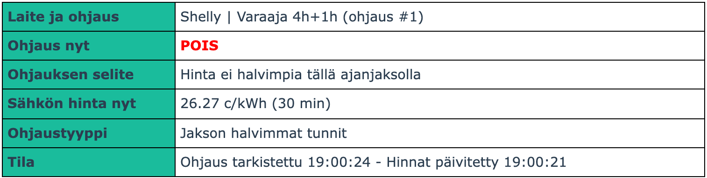

Laitteelle ei ole annettu nimeä Shellyn hallinnassa. Nimen voit asettaa kohdasta `Settings` -> `Device name`.

Nimi kannattaa asettaa erityisesti, jos käytössä on useampi Shelly. Nimi näkyy tilasivulla ja selaimen välilehden otsikossa, joten laitteet erottaa toisistaan helposti.

Huomaa, että tehdasasetuksena nimen kohdalla lukee laitteen malli. Tämä näkyy silti pörssisähköskriptille tyhjänä.

### Kuinka saa skriptin toimimaan Switch Add-Onin kanssa?

Testattu Shelly Pro3EM + Switch Add-on.

Kun olet asentanut add-onin, näet lähdön numeron Shellyn hallinnassa. Alla olevassa esimerkissä lähdön numero on `100`.

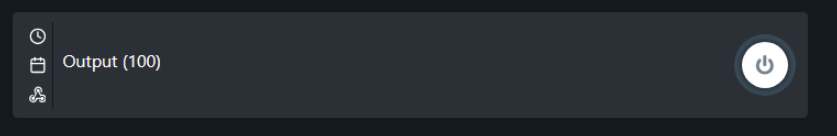

Muuta skriptin asetuksista `ohjattavat lähdöt` kyseiseen arvoon, jolloin ohjaus toimii.

### Milloin seuraavan päivän hinnat haetaan? Miksi hintoja ei näy vaikka kello on 14?

Seuraavan päivän hinnat haetaan kello 15. Elering tarjoaa uudet hinnat n. 14:30 alkaen.

Haku ei ala tasan kello 15, vaan 3-5 minuuttia sen jälkeen. Viive on laitekohtainen ja lasketaan laitteen MAC-osoitteesta, joten saman käyttöpaikan laitteet eivät hae hintoja samalla hetkellä, eikä haku osu tasatunnille, jolloin versio 3.x ja muut ohjelmat hakevat hintoja. Sama viive koskee vuorokauden vaihtuessa tehtävää varmistushakua (Eleringin rajapinta on toisinaan hetken poissa käytöstä heti keskiyön jälkeen); silloin seuraavan päivän hinnat ovat jo käytössä, joten viiveellä ei ole vaikutusta ohjaukseen. Käynnistyessä ja asetusten muuttuessa hinnat haetaan heti.

### Mihin asetukset tallentuvat?

Asetukset tallentuvat Shellyn KVS-muistiin (Advanced -> KVS): yleiset asetukset avaimeen `porssisahko` ja ohjausten asetukset avaimiin `porssisahko-1`, `porssisahko-2` ja `porssisahko-3`.

Asetukset ovat arvojen listana kiinteässä järjestyksessä, ilman asetusten nimiä. Listan ensimmäinen arvo on tallennusmuodon versio (`1`), ja tekstit kirjoitetaan heittomerkein:

```
porssisahko:    [1,'fi',25.5,7.45,5.68,['Varaaja','-','-'],1,24,0,1101,331,7,22]
porssisahko-1:  [1,1,2,[0],[0],[-2,4,-999,0,999,0,24,0,6,1,0],30,1,[0],0,0,0,60,0,2]
```

| Avain | Arvojen järjestys (asetusten nimet kuten [asetusskriptissä](dist/shelly-porssisahko-config.js)) |
| --- | --- |
| `porssisahko` | versio, `g`, `vat`, `day`, `night`, `names`, `cnt`, `hist`, `tt`, `ss`, `se`, `ds`, `de` |
| `porssisahko-1`... | versio, `en`, `mode`, [`m0.c`], [`m1.l`], [`m2.p`, `c`, `l`, `s`, `m`, `ps`, `pe`, `ps2`, `pe2`, `c2`, `s2`], `b`, `e`, `o`, `f`, `fc`, `i`, `m`, `oc`, `q` |

Muoto on tiivis, koska Shelly sallii yhdelle arvolle 253 tavua ja laskee jokaisen lainausmerkin `"` kahtena. Asetusten nimillä JSON-tekstinä ohjauksen asetukset eivät aina mahtuneet (esimerkiksi illan pakko-ohjaustunneilla). Listana pisimmätkin asetukset ovat noin puolet rajasta. Jos nimessä on lainaus- tai heittomerkki, ne näkyvät muistissa toisin päin.

Voit muokata asetuksia myös Shellyn hallinnan kautta, mutta helpommin se käy asetussivulla tai [asetusskriptillä](#asetusten-muokkaaminen-skriptin-kautta-etänä). Käsin muokatut asetukset tulevat voimaan, kun skripti käynnistetään uudestaan tai sille lähetetään pyyntö `r=r` (ks. [HTTP-rajapinta](#http-rajapinta)). Listan lopusta puuttuva arvo saa oletusarvon.

Jos käsin muokattu asetus on virheellinen (esimerkiksi rikkinäinen lista), skripti jatkaa aiemmilla asetuksilla tai oletusarvoilla eikä pysähdy.

**Version 3.x asetukset** ovat avaimissa `porssi`, `porssi-1`, `porssi-2` ja `porssi-3`. Ne luetaan kerran päivityksen yhteydessä, ja niiden mukaisesti tehdään version 10 asetukset. Sen jälkeen version 3.x asetuksia ei enää käytetä eikä niihin kirjoiteta.

Shellyn hallinnan KVS-sivu (Advanced → KVS) versiosta 3.x päivitetyssä laitteessa: version 3.x avaimet `porssi...` ja version 10 avaimet `porssisahko...` rinnakkain.

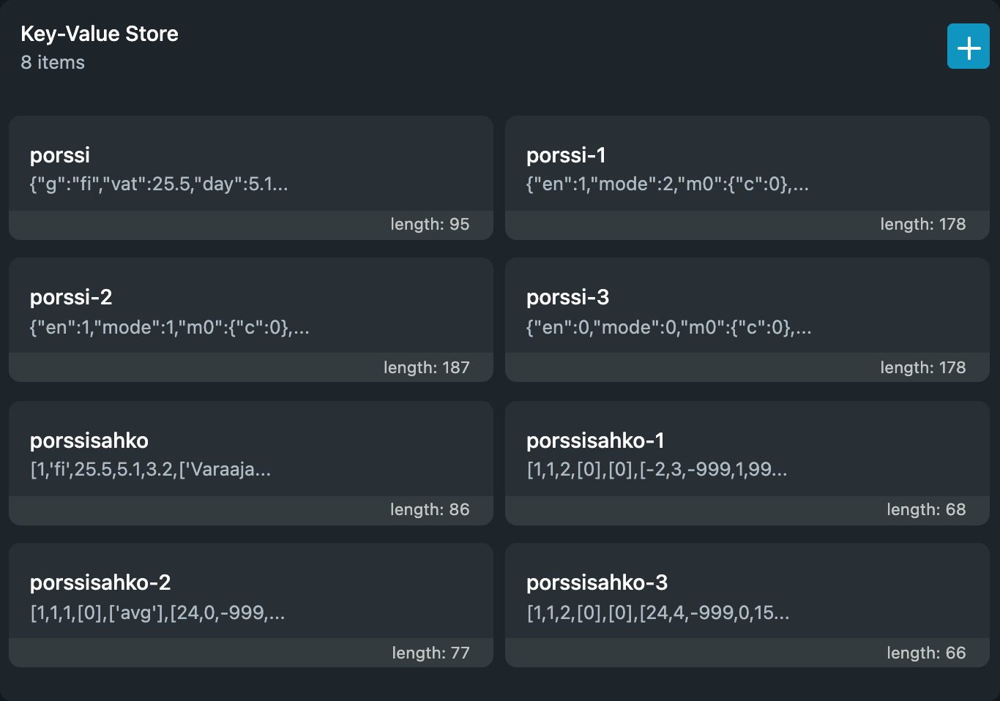

Hinnat ja historia ovat vain laitteen työmuistissa, eivätkä ne säily skriptin uudelleenkäynnistyksen tai sähkökatkon yli.

### Miksi historia on niin lyhyt?

Historian pituus on asetus (ks. [Yleiset asetukset](#yleiset-asetukset)), oletuksena 24 riviä. Rivit jaetaan käytössä olevien ohjausten kesken:

- Jos vain yksi ohjaus on käytössä, sen historiassa näkyy 24 viime ohjausta.
- Jos kaksi ohjausta on käytössä, niiden historiassa näkyy 12 viime ohjausta.
- Jos kolme ohjausta on käytössä, niiden historiassa näkyy 8 viime ohjausta.

Pituuden voi nostaa enintään 96 riviin. Yksi rivi vie muistia noin kuusi tavua.

### Miksi historiassa on rivi ajalla 00.00.0000 00:00?

Rivi on kirjattu heti laitteen käynnistyttyä, ennen kuin laite on saanut kellonajan verkosta. Näin käy tyypillisesti sähkökatkon jälkeen.

### Mitä tapahtuu kesä- ja talviaikaan siirryttäessä?

Ohjaus toimii myös kellonsiirtopäivinä, ja jaksojen rajat noudattavat kellonaikaa. Yön tunteina ennen kellonsiirtoa laite ei vielä tiedä tulevasta siirrosta, joten näiden muutaman tunnin aikana jakson raja tai siirtomaksun päivä- ja yöraja voi olla tunnin sivussa.

## Teknistä tietoa

### Yleistä

* Shellyn vähäisen muistin takia monia asioita on tehty aika rumasti
* Outoja temppuja on myös tehty minimointia helpottamaan
* Jotain muuttujia on ollut pakko laittaa globaaliksi, koska Shellyn js-moottorin pino tulee nopeasti täyteen
  * esim. silmukan `i` saattaa saada ihan yhtäkkiä oudon arvon
  * Versiossa 10 syyksi osoittautui vanhempien laiteohjelmistojen tapa käsitellä `let`- ja `const`-muuttujia,<br>
    ei niinkään pinon täyttyminen, tms. Ks. [CHANGELOG.md](CHANGELOG.md) kohta "Huomioitavaa päivittäessä"
* Lopullinen asennettava skripti on "kääntöprosessin" tulos
* Staattiset serverin tiedostot pakataan ja base64-enkoodataan
* Pääskripti minimoidaan. Lisäosien omaa osaa ei minimoida, jotta lisäosan asetuksia koodissa voi muokata laitteen skriptieditorissa
* Käyttää [Eleringin CSV-apia](https://dashboard.elering.ee/assets/api-doc.html#/nps-controller/getPriceAsCSVUsingGET) muistin säästämiseksi (JSON vie liikaa)
* Hinnat ja historia pidetään muistissa pakattuina merkkijonoina
* Sama skripti toimii Gen 2-, Gen 3- ja Gen 4 -laitteissa. Raskas laskenta tehdään vain pääsilmukasta,<br>
  koska Gen 2 -laitteissa kutsupino on vastauskäsittelijöiden sisällä pieni
* Lähdekoodissa alkuperäiseen versioon tehdyt muutokset on merkitty kommentilla, joka alkaa `v10:`

### Muistin käyttö

Shellyn skriptimuisti on noin 25 kilotavua, ja se on yhteinen laitteen kaikille skripteille.

|  | Alkuperäinen 3.4.0 | Versio 10.0.0 |
| --- | --- | --- |
| Käytössä levossa, kolme ohjausta | noin 9,8 kt | noin 9,1 kt |
| Huippu hintoja haettaessa, kolme ohjausta | noin 19,3 kt | noin 20,1 kt |
| Huippu asetuksia tallennettaessa, kolme ohjausta | noin 21,0 kt | ei nosta huippua |
| **Suurin huippu**, kolme ohjausta | **noin 21,0 kt** (asetusten tallennus) | **noin 20,1 kt** (hintahaku) |
| Suurin huippu ajoittain (Cloudflaren lisäotsakkeet) | noin 23 kt | noin 22 kt |
| Täysi historia (72 riviä) lisää | noin 6 kt | noin 0,4 kt |
| **Yksi ohjaus** (uuden asennuksen oletus): **levossa / huippu** | - (aina kolme ohjausta) | noin 7,1-8,0 kt / 18,4-18,6 kt |

Kolmen ohjauksen luvut on mitattu samalla Shelly Outdoor Plug S Gen3:lla samoilla asetuksilla peräkkäin heti käynnistyksen jälkeen, kun molempien päivien hinnat ovat muistissa ja historia on vielä lähes tyhjä. Yhden ohjauksen luvut ovat viikon ajosta (Gen3 ja Gen4). Ajoittaisen huipun lisä (noin 2 kt) on molemmille sama, ja alkuperäisessä se koskee myös asetusten tallennusta, koska tallennus hakee hinnat uudelleen. Kilotavu (kt) on tässä 1000 tavua, ei 1024. Nykyiset arvot näkyvät tilasivun alatunnisteessa.

Ajoittainen korkeampi huippu johtuu siitä, että Eleringin edessä oleva Cloudflare lisää osaan vastauksista ylimääräisiä HTTP-otsakkeita. Skripti ei voi vaikuttaa siihen. Lisäotsakkeet tulevat satunnaiseen osaan vastauksista kaikilla Shelly-malleilla.

Muistin riittävyyttä kannattaa arvioida ajoittaisen huipun mukaan: yhdellä ohjauksella muille skripteille jää noin 4,6 kilotavua, kolmella ohjauksella noin 3 kilotavua.

Muistin käyttöön voi vaikuttaa näillä:

* **Ohjausten määrä:** noin 0,7 kilotavua per ohjaus, vaikka ohjaus ei olisi käytössä ([Yleiset asetukset](#yleiset-asetukset))
* **Historian pituus:** noin 6 tavua per rivi, eli 96 riviä vie noin 0,6 kilotavua ([Yleiset asetukset](#yleiset-asetukset))
* **Lisäosaversio:** noin 0,6-0,7 kilotavua enemmän kuin tavallinen skripti
* **Laitteen muut skriptit:** ne käyttävät samaa muistia

Tarkemmat mittaukset, suoritusajat ja tietorakenteet: [docs/vertailu-3.4.0.md](docs/vertailu-3.4.0.md).

### Skriptin kääntäminen

1) Asenna Node.js
2) Kloonaa repository ja avaa terminaali `shelly-porssisahko`-kansiossa
3) Aja komento `npm i` asentaaksesi kirjastot
4) Aja komento `npm run build` kääntääksesi projektin
5) Valmiit skriptit löytyvät `dist/`-kansiosta

Kehitysympäristö omaa laitetta vasten:

* `npm run upload` lataa pääskriptin laitteeseen. Laitteen osoite annetaan ympäristömuuttujassa `SHELLY_URL`, esimerkiksi `SHELLY_URL=http://192.168.1.50 npm run upload`. `npm start` tekee käännöksen ja latauksen peräkkäin.
* `npm run serve` tarjoaa käyttöliittymän tiedostot paikallisesti osoitteessa `http://localhost:3000`. Sivu yrittää hakea tiedot laitteesta, jonka osoite on tiedostossa `src/statics/dev.js`; oman laitteen osoitteen voi antaa tiedostossa `src/statics/dev.local.js` (ei versionhallinnassa), esimerkiksi `SRV = "http://192.168.1.50";`. Nykyiset laiteohjelmistot (mitattu 2.0.1) vastaavat kuitenkin koodilla 403 pyyntöihin, jotka tulevat muualta kuin laitteen omalta sivulta, joten paikallinen sivu ei saa laitteelta tietoja ilman selaimen suojausten ohittamista. Käyttöliittymän kehitykseen oikeilla tiedoilla sopii paremmin simulaattori selaimessa, ks. [test/README.md](test/README.md#simulaattori-selaimessa).

### Testaus

Projektissa on simulaattori, automaattiset testit ja laitetesti. Testit ajetaan komennolla `npm test`. Katso [test/README.md](test/README.md).

## License

GNU Affero General Public License v3.0 - [LICENSE.txt](LICENSE.txt)

Tämä on alkuperäisestä projektista [jisotalo/shelly-porssisahko](https://github.com/jisotalo/shelly-porssisahko) muokattu versio, ja sitä koskee sama lisenssi.

**Vastuuvapaus.** Skripti on harrastusprojekti, ja se toimitetaan sellaisenaan ilman minkäänlaista takuuta (ks. lisenssin kohdat 15 ja 16). Alkuperäinen tekijä ja muokkaaja eivät vastaa suorista eivätkä välillisistä vahingoista, jotka aiheutuvat skriptin käytöstä tai siitä, ettei sitä voi käyttää. **Ottamalla skriptin käyttöön hyväksyt, että tekijät eivät ole vastuussa, ja otat käytön riskit ja vastuun itsellesi.**

Käytetty välilehtiratkaisu pohjautuu esimerkkiin [täältä](https://alvarotrigo.com/blog/html-css-tabs/).
